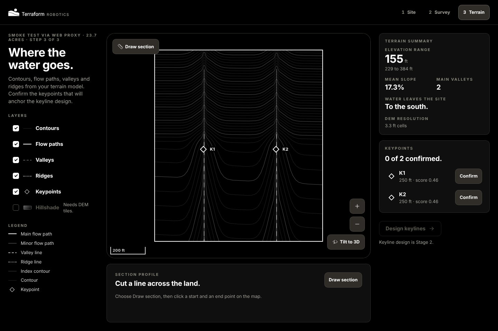

# Terraform Robotics

Site survey to regenerative design. Terraform Robotics turns ground data (drone LiDAR, public elevation, legacy drawings) into a terrain model, shows where water flows and collects, and lays out permaculture interventions such as keyline patterns. The designs are built to feed an autonomous solar keyline robot.

This repository holds **Stage 1: site to terrain**.



| Step | What the user does | Built by |
| --- | --- | --- |
| 1. Site | Names the project and sets the parcel boundary (draw or upload GeoJSON) | `apps/web`, `tr_api` |
| 2. Survey | Adds ground data: drone LiDAR (LAS/LAZ), a DEM, contours, or fetches USGS 3DEP | `tr_api`, `tr_worker` |
| 3. Terrain | Builds the terrain model: contours, flow paths, valleys, ridges, keypoint candidates, data-quality grades | `tr_worker`, `tr_geo` |

## Layout

```
apps/web/                  Next.js web app (MapLibre)
backend/
  src/tr_geo/              Pure terrain analysis: DEM conditioning, flow, contours, keypoints
  src/tr_api/              FastAPI service over PostGIS
  src/tr_worker/           Terrain job pipeline (Cloud Run Job in production)
  sql/                     Database schema (PostGIS)
  tests/
packages/design-tokens/    Terraform Robotics design tokens (source of truth for app styling)
infra/gcp/                 Google Cloud build and deploy config
docs/                      API contract and architecture notes
```

## Run locally

Requirements: Docker, or Python 3.12+, Node 22, and PostgreSQL 16 with PostGIS 3.

**With Docker:**
```bash
cp .env.example .env
docker compose up --build
```
Web app on http://localhost:3000, API on http://localhost:8000/docs.

**Without Docker:**
```bash
# database
createdb terraform && psql terraform -f backend/sql/001_init.sql

# backend
cd backend
python -m venv .venv && source .venv/bin/activate
pip install -e ".[dev]"
export DATABASE_URL=postgresql+psycopg://localhost/terraform
uvicorn tr_api.main:app --reload

# web (separate shell)
cd apps/web && npm install && npm run dev
```

Run tests with `cd backend && pytest`.

## How terrain jobs run

The API records a job and dispatches it. Locally (`JOB_RUNNER=inline`) the API runs it in a background thread. On Google Cloud (`JOB_RUNNER=cloudrun`) it starts the `terrain-worker` Cloud Run Job with the job ID; the worker reads inputs from Cloud Storage, writes the DEM and layers back, and updates the job row as it goes.

Pipeline: fetch or ingest elevation → resample to a working DEM → condition (breach depressions) → flow direction and accumulation → valleys, ridges and flow paths → contours → keypoint candidates → data-quality grades.

## Design system

The app follows the Terraform Robotics design system (monochrome, warm greys, Helvetica Neue, flat cards, contour-arc motif). Tokens live in `packages/design-tokens/tokens.json`; `npm run tokens` in `apps/web` regenerates the CSS variables.

## Specs

- Product description, technical specification and the keyline robot brief are maintained as docs outside this repo; `docs/` holds the parts code depends on.
